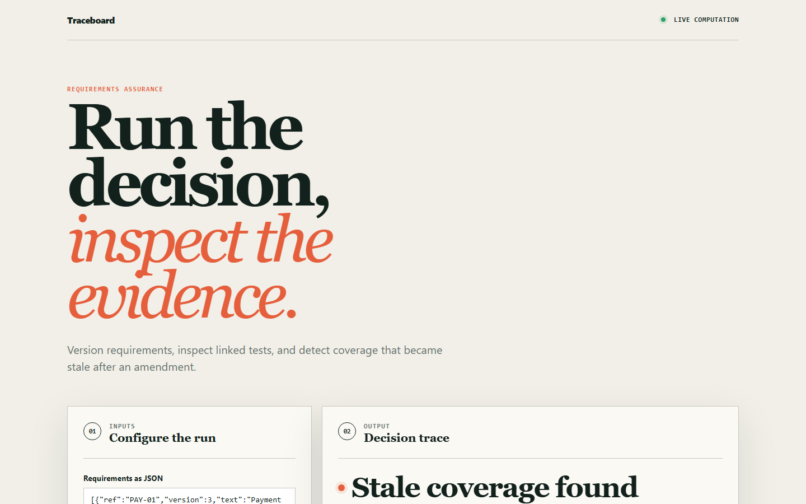
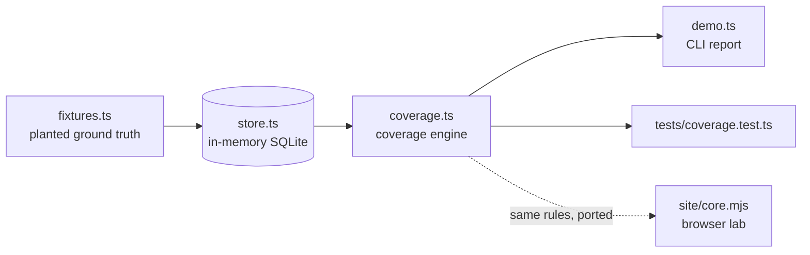

# traceboard

Requirements traceability that detects stale coverage: a test that still passes against a requirement whose wording has since changed.

[](https://github.com/SlateGitOrg/traceboard/actions/workflows/ci.yml)
[Live demo](https://slategitorg.github.io/traceboard/)



## Why

An auditor asks for the test that proves REQ-114 is met and the change request that last modified it. In most organisations that is a week of spreadsheet archaeology, and a traceability matrix reports 100% coverage on the day it is built and is quietly wrong a month later. The usual failure is an amended requirement whose old test is still green. Traceboard versions every requirement, records which version each test was written against, and derives coverage from that.

## Features

- Immutable requirement versions; the database rejects in-place edits.
- Four coverage states per requirement: `COVERED`, `STALE_COVERED`, `FAILING`, `UNCOVERED`.
- Orphan detection in the other direction: tests linked to no requirement.
- Two headline numbers: what a spreadsheet would report and what is actually true.
- Impact analysis: tests, defects and change requests affected by a requirement.
- Audit pack: a Markdown evidence bundle with amendment history, linked tests and related defects.
- A static browser lab (`site/`) that runs the freshness rule on JSON you edit.

## Architecture



`store.ts` defines the schema (`requirement`, `requirement_version`, `test_case`, `coverage_link`, `defect`, `change_request`) and the write helpers. `coverage.ts` holds all classification and reporting logic. Details are in [docs/ARCHITECTURE.md](docs/ARCHITECTURE.md).

## Quick start

Prerequisites: Node.js 24 recommended (22.18+ works). No install step, no dependencies, no build: TypeScript runs through Node's native type stripping and the store uses the built-in `node:sqlite`.

```bash
git clone https://github.com/SlateGitOrg/traceboard.git
cd traceboard
npm test        # unit tests, including the planted-defect suite
npm run demo    # coverage report and an audit pack
```

On Node 22.6 to 22.17, add `--experimental-strip-types` (for example `node --experimental-strip-types src/demo.ts`).

## Example

`npm run demo` builds a seven-requirement fixture and prints (trimmed):

```text
  What a traceability spreadsheet reports:  57% covered
  What is actually true:                    29% covered
  The gap is 2 requirement(s) whose tests are green and
  testing the previous wording.

  requirement  ver  state          evidence
    REQ-101     v1   COVERED        T-001@v1(pass)
  !!REQ-102     v2   STALE_COVERED  T-002@v1(pass)
  !!REQ-114     v1   UNCOVERED      -
    REQ-120     v1   COVERED        T-010@v1(pass) T-011@v1(pass)
  !!REQ-127     v2   STALE_COVERED  T-020@v1(pass)
  !!REQ-131     v1   UNCOVERED      -
  !!REQ-140     v1   FAILING        T-030@v1(fail)
```

It then lists the two orphaned tests (`T-900`, `T-901`) and prints the audit pack for `REQ-102`, showing v1, v2 under `CR-2026-014`, and `T-002` marked **STALE**.

## How it works

- **Classification** (`coverageFor`): no links is `UNCOVERED`; links but no passing test is `FAILING`; a passing test on the current version is `COVERED`; otherwise `STALE_COVERED`, with an explanation that names both versions.
- **Versioning** (`amendRequirement`): always inserts version N+1. A trigger on `requirement_version` aborts any update.
- **Links** (`link`): stores the requirement's current version in `covers_version`, so re-linking after review restores `COVERED`.
- **Summary** (`summarise`): naive percentage counts covered plus stale; true percentage counts covered only.
- **Browser lab** (`site/core.mjs`): a simplified port of the same rule over JSON input. A passing test on the current version is fresh; a test linked to an older version is stale.

## Testing

```bash
npm test
```

`tests/coverage.test.ts` asserts that every planted uncovered requirement, stale-covered requirement and orphaned test in `src/fixtures.ts` is found, that genuinely covered requirements are not flagged, that amendments flip `COVERED` to `STALE_COVERED`, that version rows are immutable, and that impact analysis and the audit pack are correct. `site/core.test.mjs` covers the browser logic. CI also runs `scripts/validate_site.py` and deploys `site/` to GitHub Pages.

## Project layout

```text
src/            store (schema, writes), coverage engine, fixtures, demo
tests/          coverage engine tests
site/           static browser lab (deployed to GitHub Pages)
scripts/        site validation
docs/           architecture notes and screenshots
```

## Limitations

- The store is in-memory SQLite seeded from a fixture; there are no importers or persistence.
- Approval state is stored but not enforced.
- Traceboard flags that a requirement changed after its test was linked; it does not judge whether the change invalidates the test.

## License

MIT — see [LICENSE](LICENSE).
