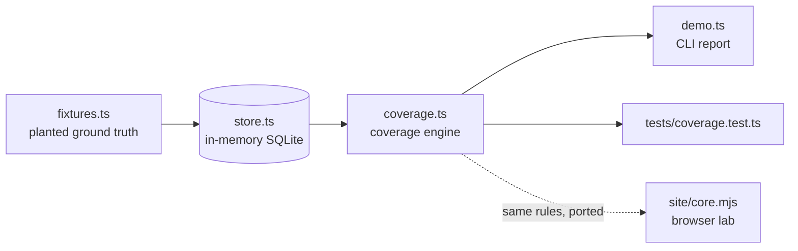

# Architecture

## Context

Teams that work under audit (clinical software, medical devices, finance) must show, for any requirement, the test that proves it and the change that last touched it. A traceability spreadsheet answers that on the day it is built and drifts afterwards: a requirement is amended, the linked test stays green, and the sheet still says "covered". Traceboard models requirements as immutable versions so that drift becomes a computable state.

## Container view

`store.ts` owns the schema and write helpers, `coverage.ts` owns every read and all classification logic, and `demo.ts` and the tests are thin consumers. The browser lab in `site/` re-implements the freshness rule over JSON input so it runs with no backend.

## Key decisions

### Requirements are immutable versions, not mutable rows

A requirement has a stable identity (`requirement`) and one row per amendment (`requirement_version`). A trigger aborts any `UPDATE` on a version row. Alternative considered: a single mutable row plus an audit log. That makes "which wording did this test cover?" a reconstruction problem; with immutable versions it is a plain integer comparison.

### A coverage link records the version it was written against

`coverage_link.covers_version` is captured when the link is created. Coverage is then derived, never stored: a passing test linked to the current version is `COVERED`, to an earlier version is `STALE_COVERED`. Re-linking after reviewing the test restores `COVERED`.

### Four requirement states, plus orphaned tests

`COVERED`, `STALE_COVERED`, `FAILING`, `UNCOVERED` for requirements; orphaned tests (linked to no requirement) are reported separately because they are the other half of the audit question.

### Report two coverage numbers

`summarise` returns a naive percentage (anything with a green test) and a true percentage (current-version coverage only). The gap is the stale count.

## Failure modes

- A requirement is amended and nobody re-links its tests: reported as `STALE_COVERED`, with an explanation naming both versions.
- A test turns red: the requirement becomes `FAILING`; one passing test against the current version is still enough when several are linked.
- A requirement has no evidence: the audit pack says so explicitly instead of omitting the section.

## Out of scope

- Importers for issue trackers or JUnit XML, and a persistent database: the store is in-memory SQLite, seeded by a fixture.
- Approval workflows. `approved` is stored but not enforced.
- Judging whether an amendment actually invalidates a test; Traceboard flags that a human should look.
